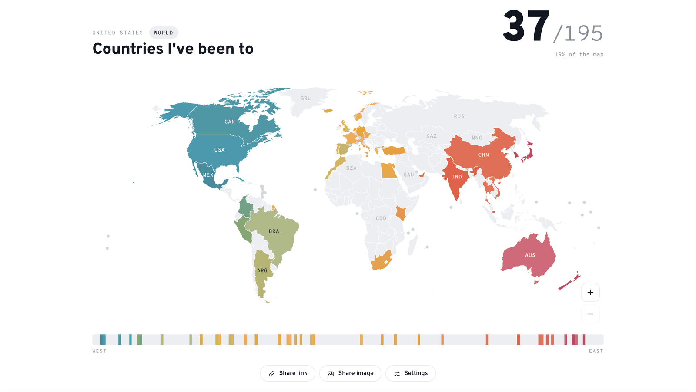
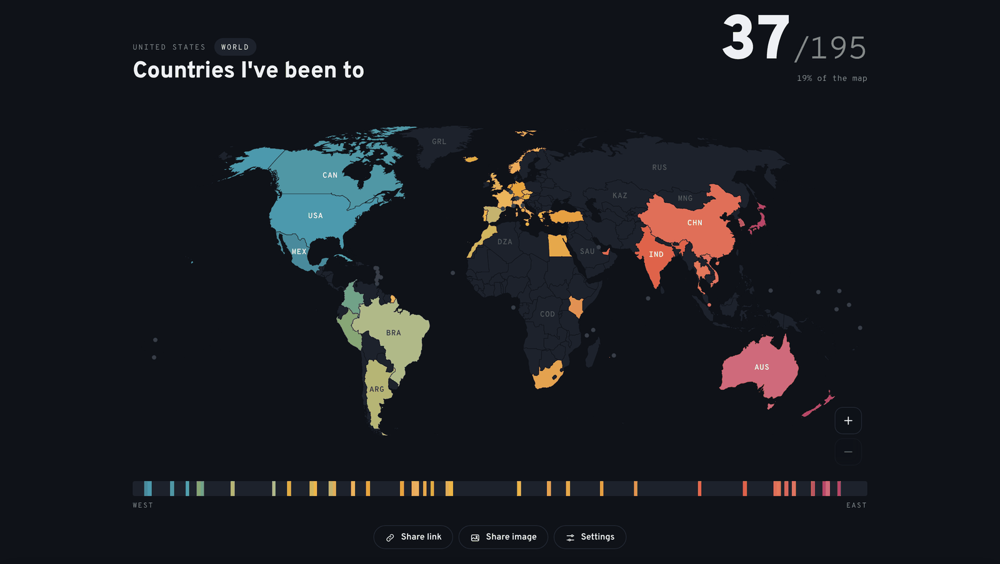
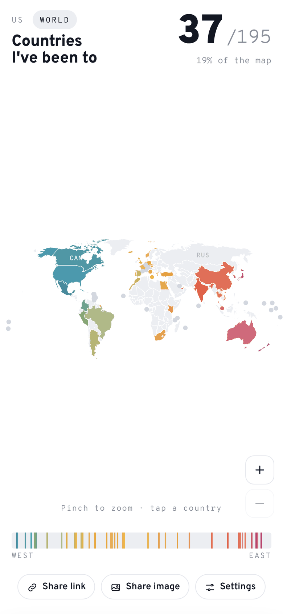
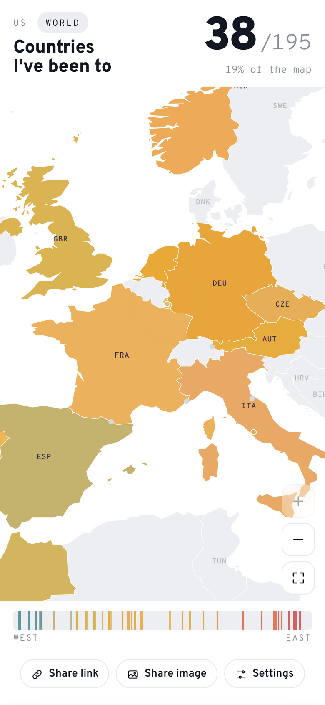
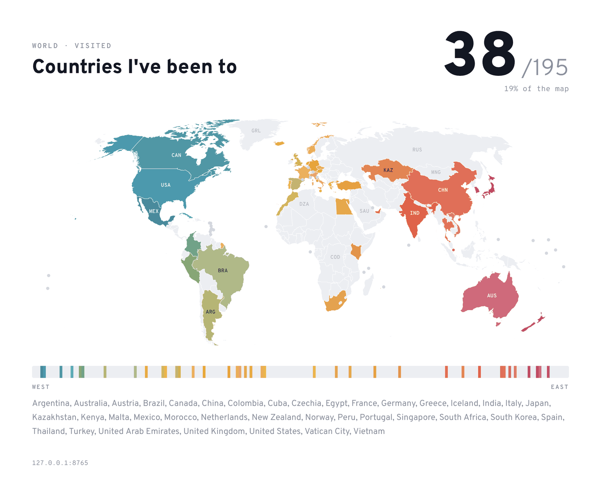

# Fifty Stars

**A minimal map of the US states and the countries you've been to.** Tap a place to mark it. Every visited place gets its own shade, so the map turns into a gradient from west to east as you travel. Two tabs at the top switch between **United States** and **World**. No sign-up, no backend: your maps live in your browser and in the link.

### → [ed-asriyan.github.io/fifty-stars](https://ed-asriyan.github.io/fifty-stars/)

<table>
  <tr>
    <th>Light</th>
    <th>Dark</th>
  </tr>
  <tr>
    <td></td>
    <td></td>
  </tr>
  <tr>
    <td></td>
    <td></td>
  </tr>
</table>

## Features

- **Two maps, one page.** The United States (50 states, D.C. optional) and the World (195 countries). Each tab keeps its own visited list, palette and title; theme and display settings are shared.
- **Click to mark.** Click or tap a place, or use the list in Settings. The world list is grouped by region with a count per region, and both lists have a search box.
- **Zoom in for the small places.** Pinch on a phone, pinch on a trackpad, Ctrl/Cmd + scroll, or the + and − buttons. Drag to move around. A tap only marks a place when your finger didn't move, so panning and pinching never toggle anything by accident. Codes stay the same size on screen and smaller places get theirs once they're big enough.
- **Tiny countries are tappable.** Places too small to see at world scale (Singapore, Malta, Vatican City, the island nations) get a dot that steps aside once you zoom in far enough.
- **One screen.** On any device the tabs, title, map, colour strip and buttons fit in the first screen; the map takes the space that's left and sits centred in it.
- **Each place its own colour.** A place's colour comes from the palette gradient by how far east it is, with a small fixed variation per place so neighbours never blend. The strip under the map shows the same colours in west-to-east order.
- **The link is the map.** The URL hash always reflects the map on screen, for example `#v=CA.OR.WA&p=pacific` or `#m=world&v=FR.JP.MX`. Send it to anyone and they see exactly your map.
- **Share link** opens the system share sheet on phones and copies the link on desktop.
- **Share image** renders a clean card (title, count, map, colour strip, list of places) and shares it as a PNG. Where file sharing isn't available it copies the image to the clipboard, or saves it.
- **Six palettes:** Mesa, Pacific, Ember, Bloom, Slate, Confetti.
- **Screenshot mode** hides the buttons and the inactive tab for a clean screen capture.
- **Light and dark themes.** By default the page matches your system; Settings → Theme pins Light or Dark. The shared image uses whichever theme is on screen.
- **Installable PWA** that works offline after the first visit.
- **Backup and restore** each map as a short JSON snippet.

<p align="center">
  
  &nbsp;
  
  &nbsp;
  
  &nbsp;
  
</p>

### The shareable image

<table>
  <tr>
    <td></td>
    <td></td>
  </tr>
</table>

## What counts on the World map

The total is **195**: the 193 UN member states plus the two UN observer states, the Vatican and Palestine. The map also shows other places, such as Greenland, Puerto Rico, Hong Kong, Taiwan and Kosovo. You can mark them, but they only count towards the total when **Count all places** is on in Settings, which raises it to 239.

## Shared links

The hash holds the parts of the map that define it:

| Key   | Meaning                                         | Example          |
| ----- | ----------------------------------------------- | ---------------- |
| `m`   | Which map; omitted for the United States        | `m=world`        |
| `v`   | Visited places, two-letter codes (ISO 3166-1 for countries) | `v=CA.OR.WA` |
| `p`   | Palette (omitted for the default)               | `p=pacific`      |
| `t`   | Title, URL-encoded                              | `t=Road%20trips` |
| `dc`  | US: count Washington, D.C. (total 51)           | `dc=1`           |
| `all` | World: count all places, not only the 195       | `all=1`          |

When you open the site, the map on screen is written into the hash, and every change updates it in place (with `history.replaceState`, so the back button isn't flooded). Links made before the World tab existed (`#v=…` without `m`) still open the US map.

When you open **someone else's** link and you already have a map of your own, the page shows their map with a banner. Your saved map stays untouched until you choose **Save as my map**, or you go back with **Open my map**. If you have no map yet, the shared one simply becomes yours.

Display preferences (theme, codes on the map, the list under the map, screenshot mode) are personal and never go into the link.

## Install as an app

- **iPhone / iPad:** open the site in Safari → Share → *Add to Home Screen*.
- **Android:** Chrome menu → *Install app*.
- **Desktop Chrome / Edge:** the install icon in the address bar.

The service worker caches the page, the world map data, the pinned map libraries and the fonts on first load, so both maps open offline afterwards.

## How it works

A single static `index.html`, plus `data/world.json` for the World tab.

- **US map:** [d3 v3](https://github.com/d3/d3/tree/v3.5.17) draws the states with the `albersUsa` projection, which places Alaska and Hawaii as insets. State shapes come from the TopoJSON bundled with [Datamaps 0.5.9](https://github.com/markmarkoh/datamaps); if that isn't available the page falls back to [us-atlas](https://github.com/topojson/us-atlas) (Census Bureau 2017 boundaries).
- **World map:** `data/world.json` is built by `tools/build_world.py` from [Natural Earth](https://www.naturalearthdata.com/) 1:50m admin-0 countries and tiny-country points (public domain). The script projects everything with the Natural Earth I projection into the SVG viewBox ahead of time, drops Antarctica, cuts every ring at the points where neighbours change so each shared border is stored once as a TopoJSON arc, simplifies each arc once (Douglas–Peucker, 0.2 viewBox units) so neighbours never get slivers, and writes country names, regions, label points and the UN list alongside. The page draws it with `d3.geo.path().projection(null)`. About 230 KB, 80 KB gzipped.
- **Colour:** each place's centroid gives a position `t` from 0 (west) to 1 (east). `t` is nudged by a hash of the code, then mapped through the palette stops with Lab interpolation, and lightness and saturation get their own small hashed offsets. The result is stable between visits and different for every place.
- **Storage:** `localStorage` keys `fifty-stars:v1` (US map), `fifty-stars:world:v1` (World map), `fifty-stars:prefs` (theme and display) and `fifty-stars:mode` (last tab).
- **Zoom:** written on Pointer Events rather than d3's zoom behaviour, so a tap and a drag are told apart explicitly. The map group carries `translate(x,y) scale(k)` in viewBox units. At rest the map is centred; zoomed in it gets up to half a box of slack, so the point under your fingers stays put even when a wide map sits in a tall phone screen. Borders use `vector-effect: non-scaling-stroke`, and the map box has `touch-action: none` so the browser doesn't zoom the whole page.
- **Image:** the share card is drawn on a `<canvas>` from the same paths and exported at 2× as PNG, then passed to the Web Share API (`navigator.share({ files })`), the async Clipboard API, or a download, in that order.
- **Offline:** `sw.js` uses network-first for the page, cache-first for the pinned CDN files and fonts, and stale-while-revalidate for its own assets.

Typeface: [Overpass](https://fonts.google.com/specimen/Overpass), an open-source cousin of Highway Gothic, the lettering on US road signs.

## Run locally

```sh
git clone https://github.com/ed-asriyan/fifty-stars.git
cd fifty-stars
python3 -m http.server 8000
```

Open http://localhost:8000. The service worker registers only over HTTPS, so offline mode works on GitHub Pages, not on a plain local server.

To rebuild the world data, get `ne_50m_admin_0_countries.geojson` and `ne_50m_admin_0_tiny_countries.geojson` from [natural-earth-vector](https://github.com/nvkelso/natural-earth-vector/tree/master/geojson) and run:

```sh
python3 tools/build_world.py ne_50m_admin_0_countries.geojson ne_50m_admin_0_tiny_countries.geojson data/world.json
```

It needs only the Python standard library.

## Backup format

Settings → Backup → **Copy backup** gives you the map on screen:

```json
{ "map": "world", "visited": ["FR", "JP", "MX"], "palette": "mesa", "title": "Countries I've been to" }
```

Paste it back with **Restore from text** on the same tab. A plain array of codes also works.
