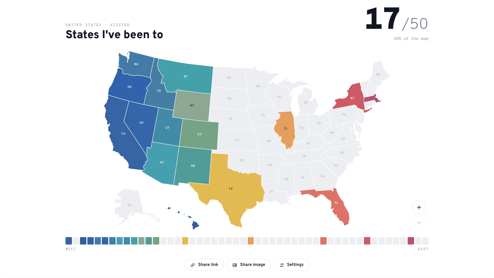
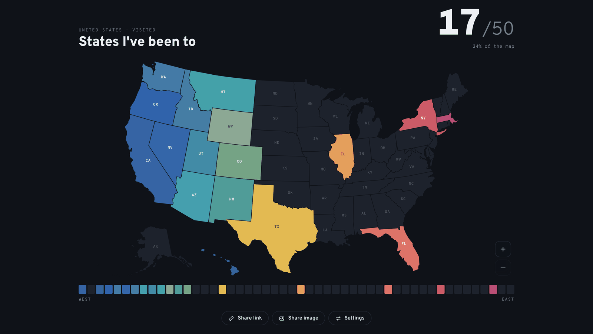
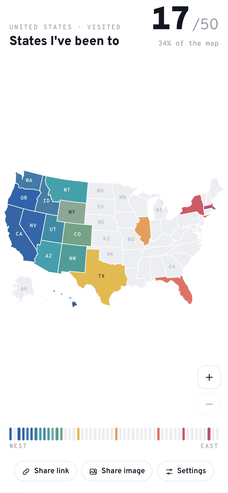
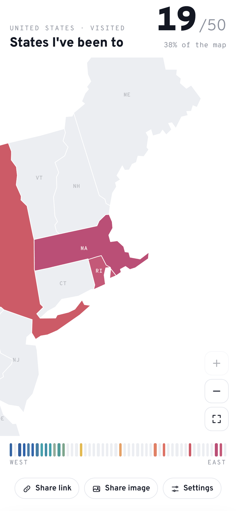
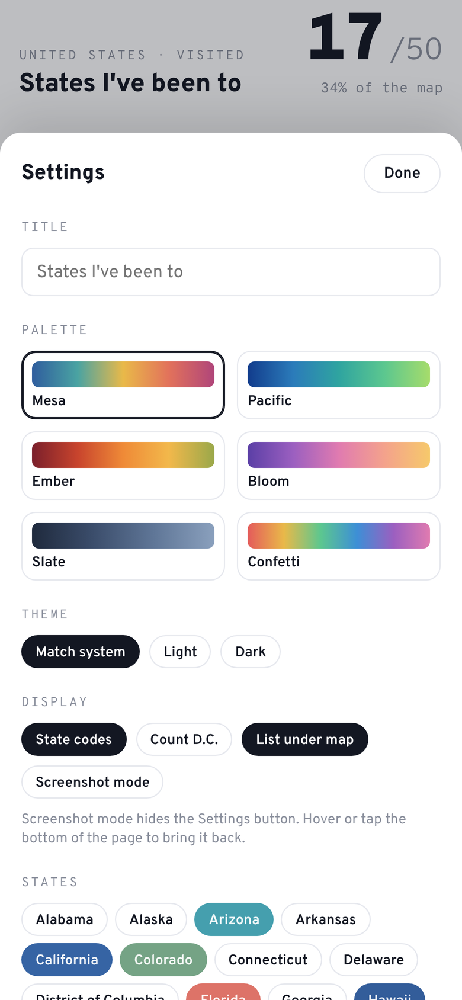
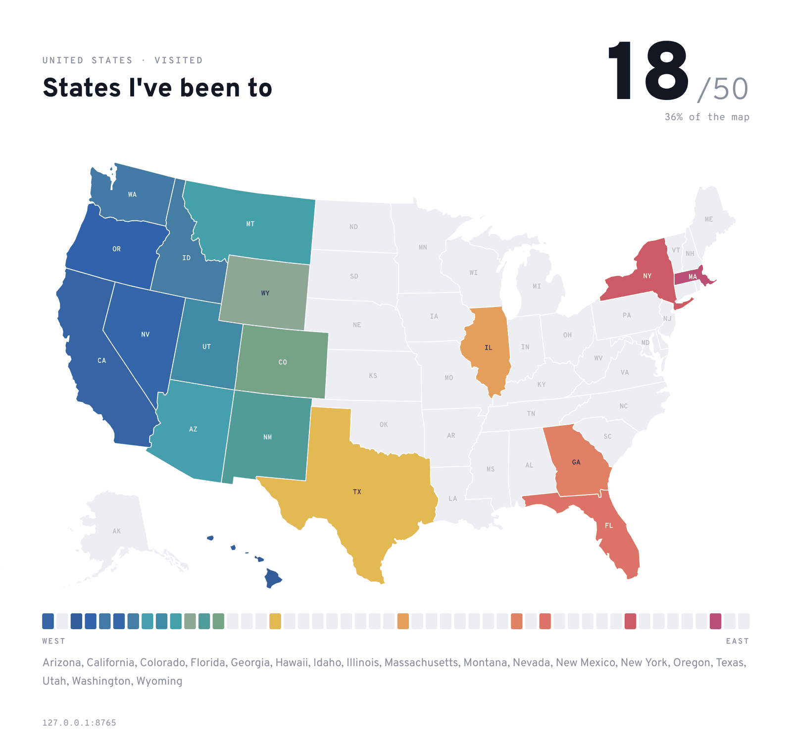

# Fifty Stars

**A minimal map of the US states you've been to.** Tap a state to mark it. Every visited state gets its own shade, so the map turns into a gradient from coast to coast as you travel. No sign-up, no backend: your map lives in your browser and in the link.

### → [ed-asriyan.github.io/fifty-stars](https://ed-asriyan.github.io/fifty-stars/)

<table>
  <tr>
    <th>Light</th>
    <th>Dark</th>
  </tr>
  <tr>
    <td></td>
    <td></td>
  </tr>
</table>

## Features

- **Click to mark.** Click or tap a state, or use the state list in Settings.
- **Zoom in for the small states.** Pinch on a phone, pinch on a trackpad, Ctrl/Cmd + scroll, or the + and − buttons. Drag to move around. A tap only marks a state when your finger didn't move, so panning and pinching never toggle anything by accident. State codes stay the same size on screen and the small states get theirs once they're big enough.
- **One screen.** On any device the title, the map, the colour strip and the buttons fit in the first screen; the map takes the space that's left and sits centred in it.
- **Each state its own colour.** A state's colour comes from the palette gradient by how far east it is, with a small fixed variation per state so neighbours never blend. The strip under the map shows the same colours in west-to-east order.
- **The link is the map.** The URL hash always reflects your current map, for example `#v=CA.OR.WA&p=pacific`. Send it to anyone and they see exactly your map.
- **Share link** opens the system share sheet on phones and copies the link on desktop.
- **Share image** renders a clean card (title, count, map, colour strip, list of states) and shares it as a PNG. Where file sharing isn't available it copies the image to the clipboard, or saves it.
- **Six palettes:** Mesa, Pacific, Ember, Bloom, Slate, Confetti.
- **Screenshot mode** hides the buttons for a clean screen capture.
- **Light and dark themes.** By default the page matches your system; Settings → Theme pins Light or Dark. The shared image uses whichever theme is on screen.
- **Installable PWA** that works offline after the first visit.
- **Backup and restore** your map as a short JSON snippet.

<p align="center">
  
  &nbsp;
  
  &nbsp;
  
</p>

### The shareable image

<p align="center">
  
</p>

## Shared links

The hash holds the parts of the map that define it:

| Key  | Meaning                               | Example                 |
| ---- | ------------------------------------- | ----------------------- |
| `v`  | Visited states, two-letter codes      | `v=CA.OR.WA`            |
| `p`  | Palette (omitted for the default)     | `p=pacific`             |
| `t`  | Title, URL-encoded                    | `t=Road%20trips`        |
| `dc` | Count Washington, D.C. (total is 51)  | `dc=1`                  |

When you open the site, your saved map is written into the hash, and every change updates it in place (with `history.replaceState`, so the back button isn't flooded).

When you open **someone else's** link and you already have a map of your own, the page shows their map with a banner. Your saved map stays untouched until you choose **Save as my map**, or you go back with **Open my map**. If you have no map yet, the shared one simply becomes yours.

Display preferences (theme, state codes, the list under the map, screenshot mode) are personal and never go into the link.

## Install as an app

- **iPhone / iPad:** open the site in Safari → Share → *Add to Home Screen*.
- **Android:** Chrome menu → *Install app*.
- **Desktop Chrome / Edge:** the install icon in the address bar.

The service worker caches the page, the pinned map libraries and the fonts on first load, so the map opens offline afterwards.

## How it works

It's a single static `index.html` with no build step.

- **Map:** [d3 v3](https://github.com/d3/d3/tree/v3.5.17) draws the states with the `albersUsa` projection, which places Alaska and Hawaii as insets. State shapes come from the TopoJSON bundled with [Datamaps 0.5.9](https://github.com/markmarkoh/datamaps); if that isn't available the page falls back to [us-atlas](https://github.com/topojson/us-atlas) (Census Bureau 2017 boundaries).
- **Colour:** each state's centroid longitude gives a position `t` from 0 (west) to 1 (east). `t` is nudged by a hash of the state code, then mapped through the palette stops with Lab interpolation, and lightness and saturation get their own small hashed offsets. The result is stable between visits and different for every state.
- **Storage:** `localStorage` key `fifty-stars:v1`.
- **Zoom:** written on Pointer Events rather than d3's zoom behaviour, so a tap and a drag are told apart explicitly. The map group carries `translate(x,y) scale(k)` in viewBox units, clamped so the map can't be dragged out of its box; borders use `vector-effect: non-scaling-stroke`. The map box has `touch-action: none` so the browser doesn't zoom the whole page.
- **Image:** the share card is drawn on a `<canvas>` from the same SVG paths and exported at 2× as PNG, then passed to the Web Share API (`navigator.share({ files })`), the async Clipboard API, or a download, in that order.
- **Offline:** `sw.js` uses network-first for the page, cache-first for the pinned CDN files and fonts, and stale-while-revalidate for its own assets.

Typeface: [Overpass](https://fonts.google.com/specimen/Overpass), an open-source cousin of Highway Gothic, the lettering on US road signs.

## Run locally

```sh
git clone https://github.com/ed-asriyan/fifty-stars.git
cd fifty-stars
python3 -m http.server 8000
```

Open http://localhost:8000. The service worker registers only over HTTPS, so offline mode works on GitHub Pages, not on a plain local server.

## Backup format

Settings → Backup → **Copy backup** gives you:

```json
{ "visited": ["CA", "OR", "WA"], "palette": "mesa", "title": "States I've been to" }
```

Paste it back with **Restore from text**. A plain array of codes also works.
